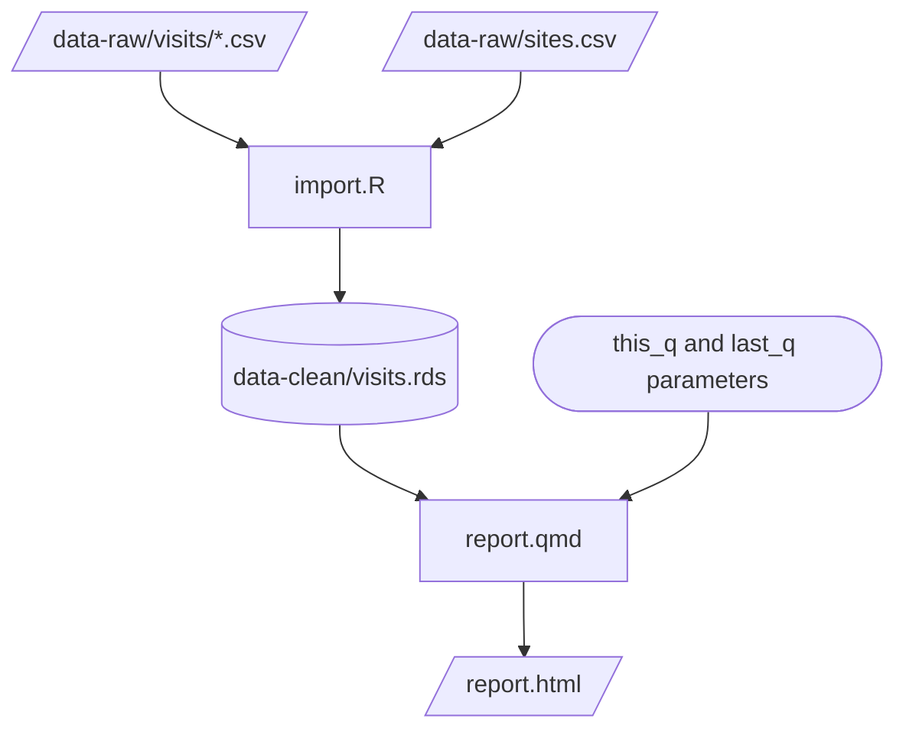

# Quarterly pantry report

This project turns monthly food pantry visit exports into a short HTML report. The report compares one fiscal quarter with the same quarter a year earlier. It shows the number of households served, visits, and people, both overall and for each pantry site.

## How it works

The project has two steps. `import.R` turns the raw exports into one clean table of visits. `report.qmd` reads that table, does all the summarizing, and produces the report.



In the diagram, slanted boxes are input and output files, rectangles are code files, the cylinder is the clean data file, and the rounded box is the settings you choose when rendering.

The report reads only `data-clean/visits.rds`. If you add new raw data and forget to rerun `import.R`, the report uses the old data and nothing warns you.

## Project layout

| Path | What it is |
|---|---|
| `data-raw/visits/` | Monthly visit exports, one CSV per month, named `visits-YYYY-MM.csv`. |
| `data-raw/sites.csv` | Lookup table that maps site codes (`PDX`, `SLM`, `EUG`, `MOB`) to site names. |
| `import.R` | Combines all monthly CSVs, cleans them, and saves one clean table of visits. |
| `report.qmd` | Quarto document that summarizes the clean visits and builds the report. **The reporting quarters are set here as parameters.** |
| `data-clean/` | Files that `import.R` creates. It deletes and rebuilds this folder on every run, so never put anything in it by hand. |
| `report.html` | The finished report. It is self-contained, so you can email it as a single file. |

## The input data

Each monthly file in `data-raw/visits/` has one row per pantry visit with these columns:

| Column | Example | Notes |
|---|---|---|
| `Visit Date` | `09/01/2026` | Month/day/year. |
| `Site` | `EUG` | Site code. It must appear in `data-raw/sites.csv`. |
| `HH ID` | `H10915` | Household ID. The same household keeps the same ID across visits. |
| `HH Size` | `2` | Number of people in the household. |
| `County` | `Lane` | Household's county. The pipeline does not currently use it. |

## What each file does

### `import.R`

- Deletes `data-clean/` and creates it again empty, so no file from an earlier run can survive.
- Finds every `.csv` file in `data-raw/visits/` and stacks them into one table.
- Reads every column as text so that one bad value in one month can't break the import, then converts the columns to the right types afterward.
- Converts column names to `snake_case` with `janitor::clean_names()`, so `Visit Date` becomes `visit_date` and `HH ID` becomes `hh_id`.
- Converts `visit_date` to a date and `hh_size` to an integer.
- **Removes all mobile pantry visits** (`site == "MOB"`). See [Open questions](#open-questions).
- **Removes duplicate visits**, meaning rows with the same household, date, and site. Only the first one is kept.
- Joins `data-raw/sites.csv` to replace site codes with site names.
- Adds a `quarter` column using the `fiscal_quarter()` function defined at the top of the script.
- Keeps only `hh_id`, `visit_date`, `quarter`, `site_name`, and `hh_size`.
- Saves `data-clean/visits.rds`, with one row per visit.

`fiscal_quarter()` returns labels like `"FY27 Q1"`. **The fiscal year starts July 1** and is named for the calendar year it ends in:

| Months | Fiscal quarter |
|---|---|
| Jul to Sep 2026 | FY27 Q1 |
| Oct to Dec 2026 | FY27 Q2 |
| Jan to Mar 2027 | FY27 Q3 |
| Apr to Jun 2027 | FY27 Q4 |

### `report.qmd`

- Takes two parameters: `this_q`, the quarter being reported on, and `last_q`, the quarter to compare it with. Both use the fiscal quarter labels above.
- Reads `data-clean/visits.rds`.
- Stops with an error if either quarter has no visits in the data. This catches typos like `FY27Q1` and quarters whose raw files haven't been added yet.
- Calculates three numbers for each quarter:
  - **households**: number of unique household IDs
  - **visits**: number of visit rows
  - **people**: sum of `hh_size` across all visits (see [Open questions](#open-questions))
- Writes a headline paragraph that compares this quarter's households with `last_q` and gives the visit and people totals.
- Shows a table by site with households for both quarters, the percent change in households, and this quarter's visits. Column headers use the quarter names, such as "FY27 Q1 households." Sites are sorted by this quarter's households, largest first.
- Code is hidden in the output (`echo: false`), and all resources are embedded in the HTML file (`embed-resources: true`).

## Producing a new quarterly report

1. Add the new monthly CSV files to `data-raw/visits/`. Keep the same column names and the `visits-YYYY-MM.csv` naming pattern.
2. If a new site has opened, add its code and name to `data-raw/sites.csv`.
3. Rebuild the clean data from the project root:

   ```sh
   Rscript import.R
   ```

4. Render the report, setting the two quarters on the command line:

   ```sh
   quarto render report.qmd -P this_q:"FY27 Q2" -P last_q:"FY26 Q2"
   ```

   Without `-P`, the report uses the defaults in the `params:` section at the top of `report.qmd`. You can also update those defaults each quarter so a plain `quarto render report.qmd` does the right thing.
5. Open `report.html` and check that the quarter in the heading is the one you expected.

`last_q` is usually the same quarter one year earlier, but it can be any quarter in the data, such as the previous quarter.

## Requirements

- R with these packages: `tidyverse` (includes `lubridate`), `janitor`, `fs`, `scales`, and `knitr`.
- [Quarto](https://quarto.org) to render the report.

The project does not use `renv`, so package versions are not pinned.

## Open questions

These are choices in the code that aren't explained anywhere. Confirm them before you rely on the numbers.

- **The mobile pantry is excluded.** `import.R` drops every `MOB` visit, even though `sites.csv` lists the mobile pantry as a site. In the data through September 2026, that's 6,655 of 48,925 raw rows (about 14%). The reason for excluding it isn't recorded.
- **"People served" counts people once per visit, not once overall.** `people` adds up household size on every visit, so a family of four that visits three times counts as 12. The report calls this "people served," but it's really person-visits. Counting unique people would mean summing `hh_size` once per household.
- **Duplicate visits are removed without a record.** Rows with the same household, date, and site are treated as data entry duplicates. In the current data, 2,184 rows are dropped this way. Check with whoever owns the source system that a household never makes two real visits to the same site on the same day.
- **County data is not used.** The raw files include `County`, but `import.R` drops it. A county breakdown would need changes to both `import.R` and `report.qmd`.

## History

The earliest version of this project was a single script. It used calendar quarters (`2026.3`) instead of fiscal quarters and printed results to the console instead of building a report. It has since been deleted.

That script was replaced by a four-step numbered pipeline: import, clean, summarize, and report. Each step saved an `.rds` file for the next. The pipeline has since been reduced to two files. Import and clean were merged into `import.R`, and the summarizing moved into `report.qmd`, with the reporting quarters as parameters instead of values typed into a script. The shared `helpers.R` was also removed, and each function now lives in the only file that uses it.
